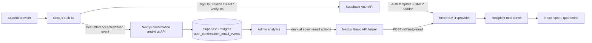
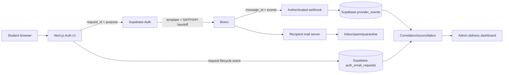

# Scholars Email Delivery Architecture

**Audit basis:** `main` at commit `137f2fa28a4f1a5b1fb6eaa55e3c6c3677bb4210`  
**Date:** 12 November 2026  
**Purpose:** Describe the observed architecture and the recommended evidence-preserving architecture. This document does not authorize production changes.

## Current architecture

## Authentication flows

### Signup

1. A user submits name, email, and password in `app/(auth)/signup/page.tsx`.
2. The browser normalizes the email and performs a password breach check.
3. The browser calls Supabase `auth.signUp()` with metadata and an allowed redirect URL.
4. If Supabase returns no session, the UI shows `components/AuthOtp.tsx`.
5. The UI records a best-effort `accepted` analytics event if the SDK call succeeded.
6. The user enters the token from the Supabase Auth email.
7. The browser calls `verifyOtp({ type: "signup" })`.
8. Supabase creates/returns the session; the application routes the user to onboarding or the safe destination.

### Confirmation resend and unconfirmed login

An unconfirmed password login displays the same OTP component. Resend calls `auth.resend({ type: "signup" })`. The component applies a 60-second client cooldown, but Supabase remains the authoritative rate limiter. The code does not create a durable application-level idempotency key for the Auth send.

### Password reset

1. The browser calls `resetPasswordForEmail()`.
2. The user is moved to the OTP screen after Supabase accepts the request.
3. The browser verifies with `verifyOtp({ type: "recovery" })`.
4. The browser calls `updateUser({ password })`.

The reset request has a three-per-ten-minute local-browser throttle. This is supplemental and does not replace Supabase limits.

### Google OAuth and legacy link compatibility

Google OAuth uses `signInWithOAuth()` and `/auth/callback`, where the server exchanges the PKCE code. The callback remains for OAuth and already-issued legacy links. Current signup and recovery screens use OTP verification rather than relying on email links.

## Email-provider boundaries

### Supabase Auth path

Supabase Auth owns token generation, expiry, single-use verification, email templates, Auth rate limits, and the configured SMTP handoff. The repository references Brevo as the SMTP/provider service, but the current connected management metadata does not expose the active SMTP configuration or Auth provider settings.

A successful browser SDK response means the Auth endpoint accepted the operation. It does not prove Brevo delivery or inbox arrival.

### Application Brevo path

`lib/email/send.ts` is a separate server-only sender. It calls Brevo's transactional API only for explicitly manual actions and only when server environment variables exist. The repository's scheduled notification worker is deliberately paused. This path should not be conflated with Auth mail.

## Current observability

The application writes `auth_confirmation_email_events` with:

- hashed email and email domain;
- request kind: signup or resend;
- request status: accepted or failed;
- optional Supabase error code;
- request timestamp;
- optional user ID.

The analytics function derives “confirmed” by checking `auth.users.email_confirmed_at`. This supports a request-to-account-confirmation funnel. It does **not** store or ingest:

- Auth handoff timestamp;
- Brevo message ID;
- provider sent/delivered/deferred/bounce/blocked/spam events;
- recipient SMTP acceptance;
- inbox or spam-folder observation;
- an end-to-end correlation ID.

The production aggregate queried during the audit showed 191 accepted events, 14 failed signup events, 42 accepted resends, and 58 accepted requests associated with a confirmed user during the preceding 30 days. These counts are not delivery-latency measurements.

## Current configuration evidence and gaps

The current source defines a six-digit OTP. An earlier repository investigation records an eight-digit token observed in production. This is a cross-system configuration-alignment risk until the live Supabase Auth Email OTP length is checked.

Public DNS for `scholars.com.ng` exposed a Brevo verification TXT record and DMARC monitoring policy (`p=none`). The actual Auth sender address and active DKIM selector are deployment/provider configuration, not source evidence, so sender-domain alignment remains unverified. No MX record was returned for the root web domain; that is not by itself a sending failure because outbound sender domains do not require the product domain to receive mail.

## Recommended target architecture

The target architecture retains Supabase Auth as the security authority. It does not move OTP generation into Scholars and does not store tokens. It adds only the evidence needed to distinguish request acceptance from delivery. Provider events must be authenticated, idempotent, redacted, and retained for a declared period.

## Target event model

For each controlled or production Auth email request, retain a non-secret request ID and purpose. The lifecycle should support these states:

`requested` → `auth_accepted` or `auth_rejected` → `provider_sent` → `provider_delivered`, `deferred`, `bounced`, `blocked`, `spam`, or `error`.

`inbox_observed` should be a test-only measurement recorded by the test harness or operator, not asserted automatically from provider acceptance. A provider event ID must be unique so retries do not duplicate state transitions.

## Security boundaries

- Browser code may contain only publishable Supabase configuration.
- SMTP passwords, Brevo API keys, service-role keys, and webhook secrets remain server-side or in provider secret storage.
- OTPs, passwords, access tokens, and full email addresses must not be logged.
- Email identity in analytics should be hashed or otherwise minimized.
- Webhook signatures and replay protection must be verified before writing events.
- Existing Supabase Auth rate limits remain enabled.
- The system must not reveal whether an email address exists through different recovery responses.
- RLS and admin authorization must protect analytics and provider-event records.

## Performance model

Measure these intervals separately:

1. Browser request start → Supabase SDK response.
2. Auth request acceptance → provider message ID/sent event.
3. Provider sent → provider delivered or deferred event.
4. Provider delivery → recipient-server/inbox observation.
5. Request start → account confirmation or password update completion.

The proposed targets are engineering goals, not guarantees: request processing under one second where practical, provider acceptance under two seconds where practical, 95% provider-delivered within 30 seconds, and 99% within 60 seconds. Recipient inbox placement remains outside Scholars' full control.

## References

[1]: https://github.com/ImperioKDB/Scholars/blob/137f2fa28a4f1a5b1fb6eaa55e3c6c3677bb4210/app/%28auth%29/signup/page.tsx "Signup request path"
[2]: https://github.com/ImperioKDB/Scholars/blob/137f2fa28a4f1a5b1fb6eaa55e3c6c3677bb4210/app/%28auth%29/login/page.tsx "Login and resend request path"
[3]: https://github.com/ImperioKDB/Scholars/blob/137f2fa28a4f1a5b1fb6eaa55e3c6c3677bb4210/app/reset-password/page.tsx "Recovery request path"
[4]: https://github.com/ImperioKDB/Scholars/blob/137f2fa28a4f1a5b1fb6eaa55e3c6c3677bb4210/lib/email/send.ts "Application Brevo API path"
[5]: https://github.com/ImperioKDB/Scholars/blob/137f2fa28a4f1a5b1fb6eaa55e3c6c3677bb4210/supabase/migrations/0103_add_confirmation_email_analytics.sql "Current analytics schema"
[6]: https://supabase.com/docs/guides/auth/auth-smtp "Supabase Auth SMTP boundary"
[7]: https://supabase.com/docs/guides/auth/auth-email-templates "Supabase template variables and OTP guidance"
[8]: https://developers.brevo.com/docs/send-a-transactional-email "Brevo message IDs and delivery events"
[9]: https://supabase.com/kb/troubleshooting/not-receiving-auth-emails-from-the-supabase-project-OFSNzw "Supabase handoff and delivery troubleshooting"
